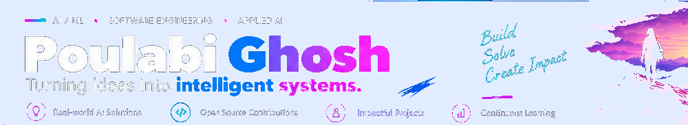
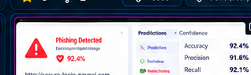
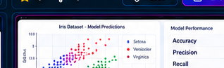

  <picture>
    <source media="(prefers-color-scheme: dark)" srcset="banner-dark.png">
    <source media="(prefers-color-scheme: light)" srcset="banner-light.png">
    
  </picture>

  <strong>AI / ML · Software Engineering · Applied AI</strong> 
  Turning ideas into intelligent systems.

  
  
  

## About Me

I'm a B.Tech CSE (AI/ML) student interested in building practical AI-powered products, solving meaningful problems, and contributing to open source. I enjoy turning complex ideas into simple, useful, and scalable solutions.

- 🎓 B.Tech CSE (AI/ML), Malla Reddy Engineering College for Women
- 🧠 Interested in applied machine learning, agentic AI, and full-stack development
- 🌱 Continuously strengthening software engineering, testing, and reproducibility
- 🤝 Open to relevant AI/ML, software engineering, and internship opportunities

## Currently

- **AI Research Engineer Intern** — Nirmata Neurotech Pvt. Ltd. *(keep this entry only if your current role and dates are accurate)*
- **Open source:** GSSoC'26 contributor *(verify the current programme status before publishing)*
- **Focus:** building projects with clear documentation, evidence, and reproducible results

## Tech Stack

  <strong>Languages</strong> 
  
  
  
  

  <strong>AI / ML & Data</strong> 
  
  
  
  

  <strong>Web / Backend</strong> 
  
  
  

  <strong>Tools</strong> 
  
  
  

## Featured Projects

<table>
  <tr>
    <td width="33%" valign="top">
      
      <h3>AARA — Agentic AI Research Assistant</h3>
      Research-gap exploration, paper analysis, and research-output generation.
       Next.js · FastAPI · ChromaDB · LLMs
       <a href="https://github.com/Poulabi8137/agentic-ai-research">Code ↗</a>
    </td>
    <td width="33%" valign="top">
      
      <h3>Self-Healing CI Agent</h3>
      CI failure analysis and fix-generation workflow. Clearly document which steps are real and which are simulated.
       Python · GitHub Actions · LLMs
       <a href="https://github.com/Poulabi8137?tab=repositories">Find repository ↗</a> · Demo only if deployed
    </td>
    <td width="33%" valign="top">
      
      <h3>IntelliRank AI Prototype</h3>
      Candidate-ranking and explainability prototype. State clearly if the interface uses mock data.
       React · FastAPI · ML
       <a href="https://github.com/Poulabi8137?tab=repositories">Find repository ↗</a>
    </td>
  </tr>
  <tr>
    <td width="33%" valign="top">
      
      <h3>E-commerce Sales ETL</h3>
      Data pipeline and visualization for sales insights. Include dataset details and reproducible outputs.
       Python · PostgreSQL · Plotly
       <a href="https://github.com/Poulabi8137?tab=repositories">Find repository ↗</a>
    </td>
    <td width="33%" valign="top">
      
      <h3>Phishing Website Detection</h3>
      ML-based detection with dataset, evaluation method, measured metrics, and limitations documented.
       Python · TensorFlow · ML
       <a href="https://github.com/Poulabi8137?tab=repositories">Find repository ↗</a>
    </td>
    <td width="33%" valign="top">
      
      <h3>Iris Classification</h3>
      Reproducible classification workflow with a documented train/test split and real evaluation results.
       Python · scikit-learn
       <a href="https://github.com/Poulabi8137?tab=repositories">Find repository ↗</a>
    </td>
  </tr>
</table>

## Achievements

- 🏆 **Second Runner-Up** — UpGrad AI Verse Hackathon, Hyderabad Edition *(add date and proof link)*
- 🌱 **Contributor** — GirlScript Summer of Code 2026, AI/Agents & Open Source Track *(verify current programme status)*
- 💼 **Infosys Springboard 6.0 Internship** *(include dates and a proof link if available)*
- 🤝 **MITS Student Partner** *(include dates and a proof link if available)*

## Let's Connect

I'm open to collaborating on practical AI/ML projects, software engineering, and open-source contributions.

- **LinkedIn:** [linkedin.com/in/poulabighosh](https://linkedin.com/in/poulabighosh)
- **Email:** [poulabighosh44@gmail.com](mailto:poulabighosh44@gmail.com)
- **GitHub:** [Poulabi8137](https://github.com/Poulabi8137)
- **Resume / Portfolio:** add your current public URL here when ready

---

Built with a focus on useful AI, sound engineering, reproducible results, and continuous learning.
